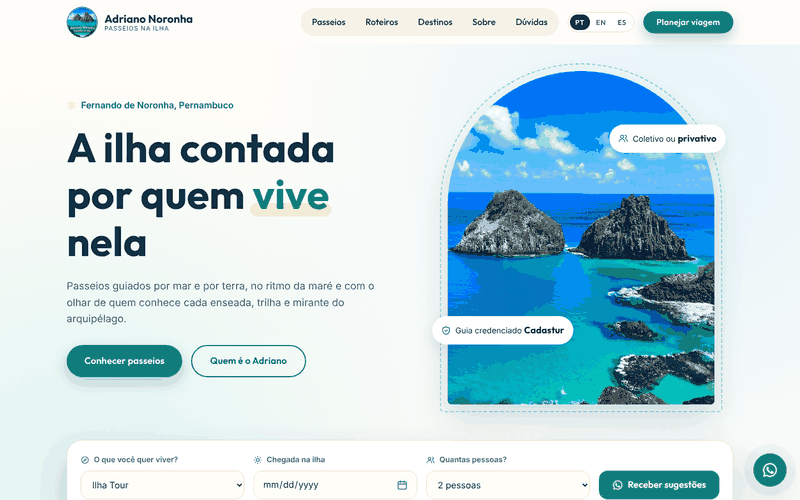
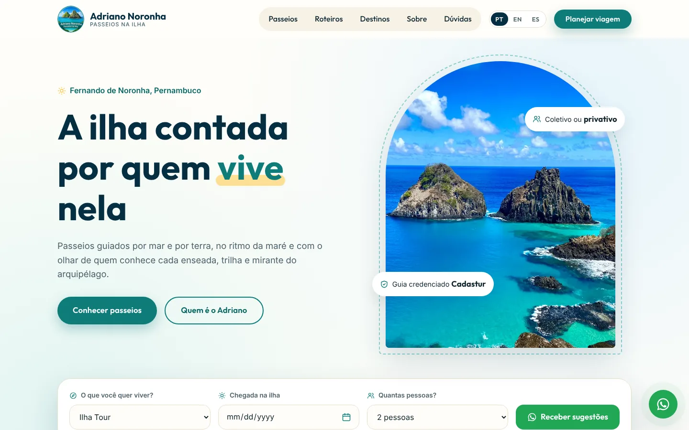

<div align="center">


# Adriano Noronha · Passeios em Fernando de Noronha

Site para um guia turístico credenciado em Fernando de Noronha, com catálogo de passeios, roteiros por duração de viagem, depoimentos reais e reserva direta pelo WhatsApp em três idiomas.

[](https://github.com/camilagermanoo/adrianoNoronha/actions/workflows/ci.yml)
[](https://adriano-noronha.vercel.app/)


**[Acessar o site →](https://adriano-noronha.vercel.app/)**



</div>

## Sobre o projeto

O Adriano é guia credenciado em Fernando de Noronha e divulgava seus passeios em uma página feita no Canva. O objetivo deste projeto foi transformar esse conteúdo em um site completo, que:

- apresente os **14 serviços reais** do guia com fotos, horários e o que está incluso;
- ajude o viajante a **escolher o que fazer** conforme o tempo que vai ficar na ilha;
- leve a pessoa ao **WhatsApp com a mensagem já escrita**, reduzindo o atrito na reserva;
- atenda **turistas estrangeiros**, que são uma parte importante do público da ilha.

## Funcionalidades

|     | Funcionalidade                   | Detalhes                                                                                                                                    |
| --- | -------------------------------- | ------------------------------------------------------------------------------------------------------------------------------------------- |
| 🌎  | **Português, inglês e espanhol** | Troca instantânea, lembra a escolha do visitante e detecta o idioma do navegador. Título, descrição e `lang` da página acompanham o idioma. |
| 💬  | **Reserva pelo WhatsApp**        | Planejador rápido, formulário de combo e botões de cada passeio geram a mensagem pronta no idioma do visitante.                             |
| 🗂️  | **Catálogo filtrável**           | Abas por categoria (Terra, Mar, Mergulho, Aluguel) com contadores e janela de detalhes acessível.                                           |
| 🗓️  | **Roteiros de 3, 5 e 7 dias**    | Linha do tempo dia a dia montada a partir do catálogo de passeios.                                                                          |
| 🎠  | **Carrossel de destinos**        | Rolagem infinita e automática, que pausa com mouse, toque ou foco e respeita `prefers-reduced-motion`.                                      |
| ⭐  | **Depoimentos reais**            | Exibidos no idioma original, com aviso de tradução nos demais idiomas.                                                                      |
| 🧭  | **Navegação inteligente**        | Menu destaca a seção visível, botão de voltar ao topo e animações suaves ao rolar.                                                          |
| 🔗  | **Prévia ao compartilhar**       | Metadados Open Graph e Twitter Card com imagem própria.                                                                                     |

<div align="center">
  
  &nbsp;
  
</div>

## Tecnologias

- **[React 19](https://react.dev/)** com **[TypeScript](https://www.typescriptlang.org/)** em modo estrito
- **[Vite](https://vite.dev/)** para desenvolvimento e build
- **CSS Modules** com design tokens em variáveis CSS
- **[vite-imagetools](https://github.com/JonasKruckenberg/imagetools)** e **[Fontsource](https://fontsource.org/)** para imagens responsivas e fontes locais
- **[Vitest](https://vitest.dev/)** e **[Testing Library](https://testing-library.com/)** para testes automatizados
- **[Oxlint](https://oxc.rs/)** e **[Prettier](https://prettier.io/)** para qualidade e padronização do código
- **GitHub Actions**, **Vercel** e **GitHub Pages** para publicação contínua

## Decisões técnicas

- **Tradução sem biblioteca externa.** Um contexto React tipado entrega os textos da interface, e cada dado (passeio, roteiro, pergunta) guarda suas versões em um tipo `Localized<T>`. Se faltar uma tradução, o TypeScript acusa o erro no build.
- **Conteúdo separado da interface.** Passeios, destinos, roteiros, depoimentos e perguntas ficam em `src/data`. Atualizar o catálogo não exige mexer em componentes.
- **Dados derivados, não duplicados.** Roteiros e formulário de contato referenciam passeios pelo `id`, então um nome alterado no catálogo se reflete em todo o site.
- **Acessibilidade desde o início.** HTML semântico, `dialog` nativo para os detalhes, `aria-current` na navegação, foco visível, textos alternativos traduzidos e respeito a `prefers-reduced-motion`.
- **Sem dependências de UI.** Ícones em SVG próprio, carrossel com `requestAnimationFrame` e animações com `IntersectionObserver`, mantendo o bundle enxuto.

## Testes

Os testes ficam ao lado do código que verificam (`*.test.ts` e `*.test.tsx`) e rodam a cada push no GitHub Actions, junto com lint, verificação de formatação e build. A publicação no GitHub Pages só acontece se todas essas etapas passarem.

- **Integridade do conteúdo**: todo passeio, roteiro, destino, pergunta e depoimento está traduzido nos três idiomas, os IDs são únicos e os roteiros só referenciam passeios existentes.
- **Idiomas**: detecção pelo navegador, escolha salva, troca de idioma e atualização do `lang` e do título da página.
- **Catálogo**: filtro por categoria, janela de detalhes e mensagem de reserva em cada idioma.
- **Formulários**: planejador e formulário de combo geram a mensagem correta para o WhatsApp, incluindo validação do nome.

## Desempenho e acessibilidade

Medido com o [Lighthouse 13](https://developer.chrome.com/docs/lighthouse) no build de produção:

|               | Desempenho | Acessibilidade | Boas práticas | SEO |
| ------------- | :--------: | :------------: | :-----------: | :-: |
| 📱 Celular    |     88     |      100       |      100      | 100 |
| 💻 Computador |    100     |      100       |      100      | 100 |

Otimizações aplicadas:

- **Imagens responsivas**: cada foto é gerada em 400, 800 e 1200 px no build com `vite-imagetools`, e o navegador baixa só o tamanho adequado à tela via `srcset` e `sizes`.
- **Fontes no próprio site**: Outfit e Inter servidas com `@fontsource`, sem a folha de estilo externa que bloqueava a renderização.
- **Prioridade de carregamento**: a foto principal usa `fetchpriority="high"` e as demais `loading="lazy"`.
- **Contraste e semântica**: cores dentro do padrão WCAG AA e listas, diálogos e abas com a semântica correta.
- **Indexação**: `robots.txt`, `sitemap.xml`, URL canônica e metadados Open Graph.

## Estrutura

```text
src/
├── assets/        imagens otimizadas em WebP
├── components/    um diretório por componente, com .tsx e .module.css
├── data/          catálogo de passeios, roteiros, destinos, depoimentos e FAQ
├── hooks/         rolagem automática, seção ativa, animação ao rolar
├── i18n/          idiomas, contexto, provider e textos da interface
├── styles/        tokens de design e estilos globais
├── test/          configuração e utilitários de teste
├── types/         tipos compartilhados
└── utils/         formatação e utilitários
```

## Como rodar

Pré-requisito: [Node.js](https://nodejs.org/) 20.19 ou superior (a versão usada no projeto está em `.nvmrc`).

```bash
git clone https://github.com/camilagermanoo/adrianoNoronha.git
cd adrianoNoronha
npm install
npm run dev
```

A aplicação ficará disponível em `http://localhost:5173`.

| Comando                | Descrição                                               |
| ---------------------- | ------------------------------------------------------- |
| `npm run dev`          | Inicia o servidor de desenvolvimento                    |
| `npm run build`        | Verifica os tipos e gera o build de produção em `dist/` |
| `npm run preview`      | Serve o build de produção localmente                    |
| `npm run lint`         | Executa a análise estática do código                    |
| `npm test`             | Executa os testes automatizados                         |
| `npm run test:watch`   | Executa os testes em modo de observação                 |
| `npm run format`       | Formata o código com Prettier                           |
| `npm run format:check` | Verifica a formatação sem alterar arquivos              |

## Deploy

O site é publicado automaticamente a cada push na branch `main`:

- **[Vercel](https://adriano-noronha.vercel.app/)**: endereço principal, via integração com o GitHub
- **[GitHub Pages](https://camilagermanoo.github.io/adrianoNoronha/)**: espelho, publicado pelo workflow `.github/workflows/ci.yml` somente depois que formatação, lint, testes e build passam

## Fluxo de trabalho

Cada mudança foi feita em uma branch própria (`feat/`, `fix/`, `refactor/`, `style/`, `docs/`, `chore/`) com commits no padrão [Conventional Commits](https://www.conventionalcommits.org/pt-br/) e mesclada na `main` com `--no-ff`, preservando o histórico de cada etapa.

## Créditos

Fotos, informações dos passeios e depoimentos pertencem a **Adriano Noronha Passeios**.

Desenvolvido por **[Camila Germano](https://github.com/camilagermanoo)**.

## Licença

O código está disponível para consulta como parte do meu portfólio, mas **não é de uso livre**. Fotos, logomarca, textos e depoimentos pertencem a Adriano Noronha Passeios. Veja os termos completos em [LICENSE](LICENSE).
